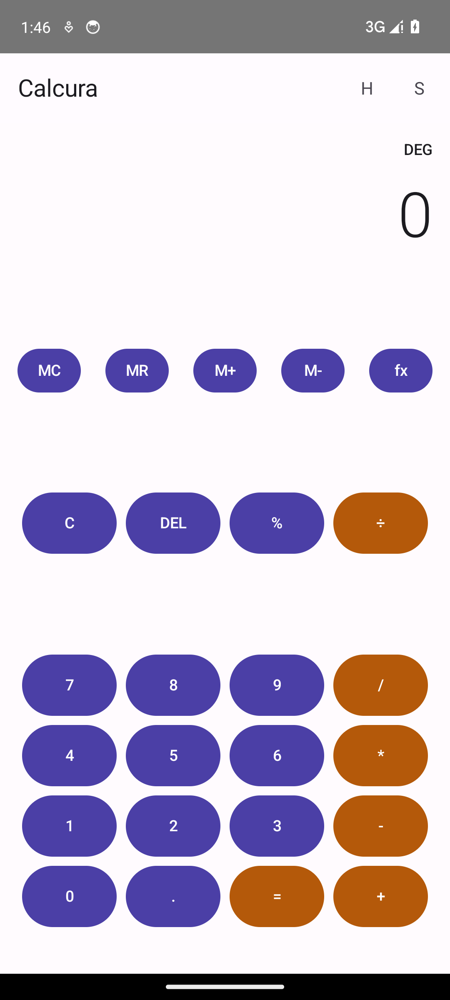
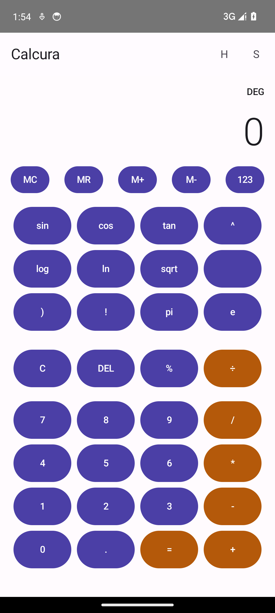
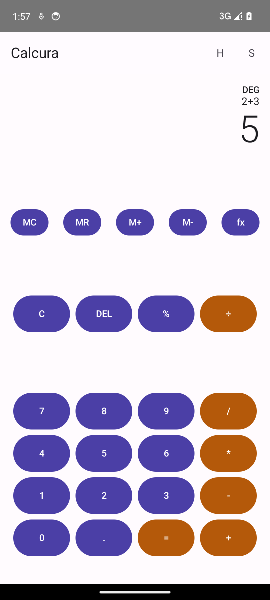
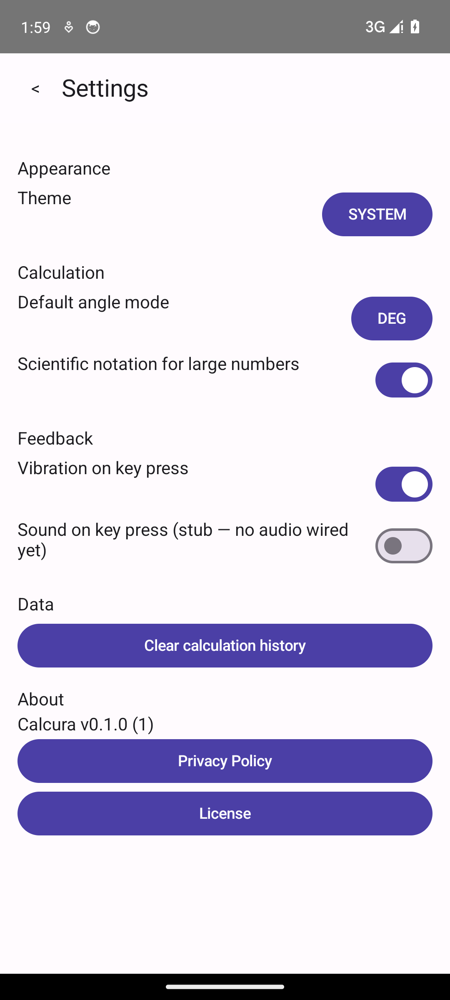
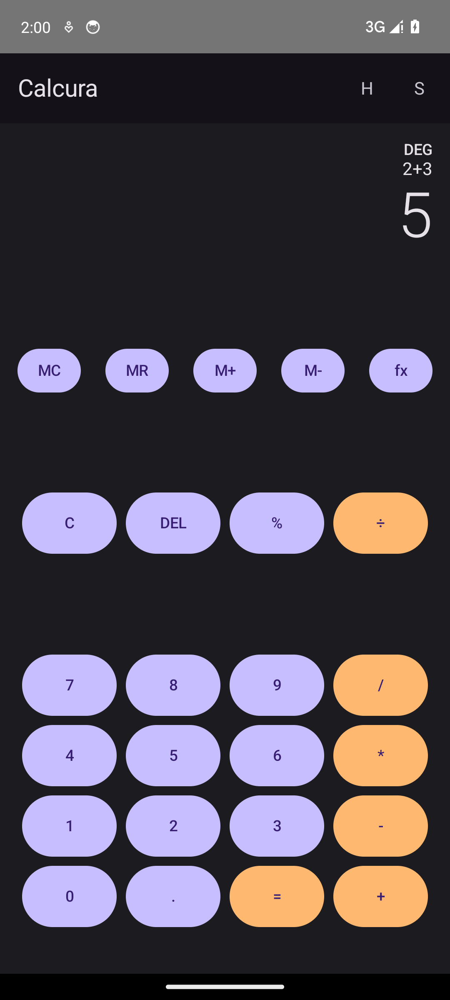

# Calcura

A scientific calculator for Android — 100% offline, Material 3, Jetpack Compose.

## Features

- Basic and scientific keypad: arithmetic, trig/hyperbolic/log functions, powers, roots,
  factorial, constants (π, e), and DEG/RAD/GRAD angle modes.
- Memory operations (MC/MR/M+/M-).
- Calculation history (Room), tap to reuse, delete one or clear all.
- Settings: theme (Light/Dark/System), default angle mode, vibration/sound toggles, decimal
  formatting, Privacy Policy and License screens.
- No network permission, no analytics or ads SDKs — nothing leaves the device.

See `docs/ARCHITECTURE.md` for the package structure and layering, and `docs/ENVIRONMENT.md`
for the toolchain this project was built and verified against.

## Install / build

```
./gradlew assembleDebug     # debug APK
./gradlew assembleRelease   # minified/shrunk release APK
```

The debug APK lands in `app/build/outputs/apk/debug/`.

## Development

Requires Java 21 and the Android SDK (platform 34, build-tools 34.0.0) — see
`docs/ENVIRONMENT.md`. `local.properties` (not committed) must point `sdk.dir` at your SDK.

## Tests

```
./gradlew testDebugUnitTest        # calculator engine unit tests (JVM, no device needed)
./gradlew connectedDebugAndroidTest # Compose UI tests (needs a device/emulator)
./gradlew lint
```

See `docs/TESTING.md` for what each suite covers and current status.

## Privacy

Calcura is fully offline. See `PRIVACY_POLICY.md`.

## License

MIT — see `LICENSE`.

## Screenshots

Captured on a Pixel 6 / Android 14 emulator:

| Main calculator | Scientific functions | Result |
|---|---|---|
|  |  |  |

| History | Settings | Dark mode |
|---|---|---|
|  |  |  |
